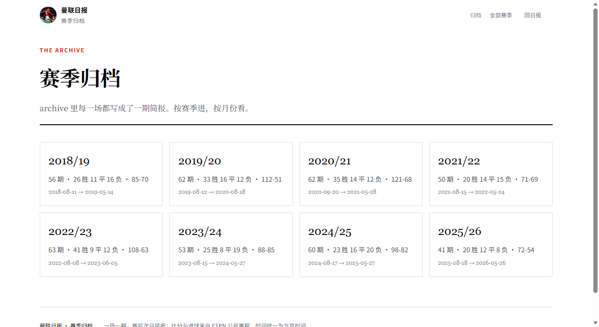
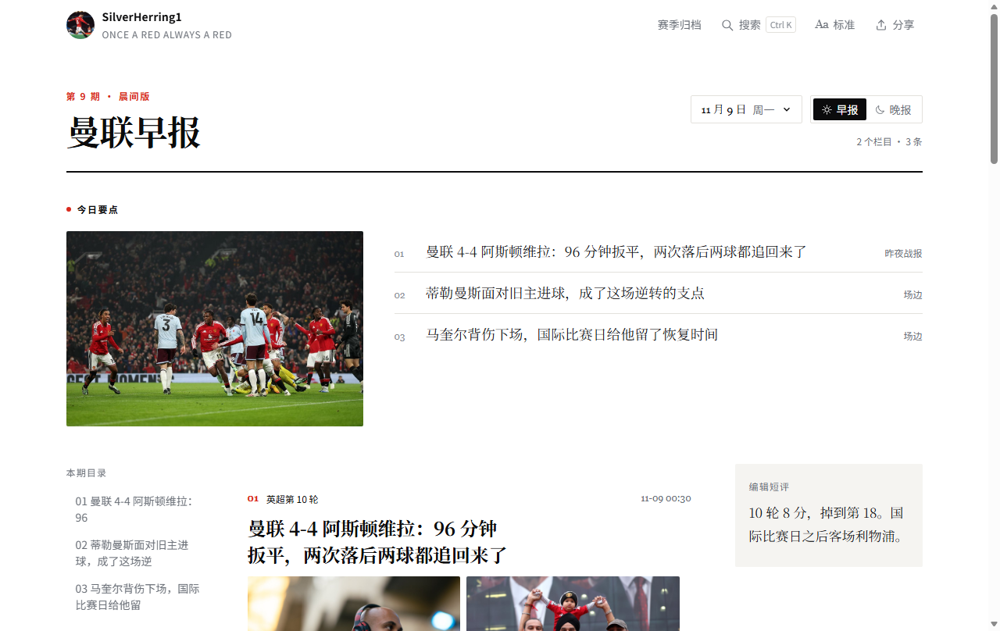
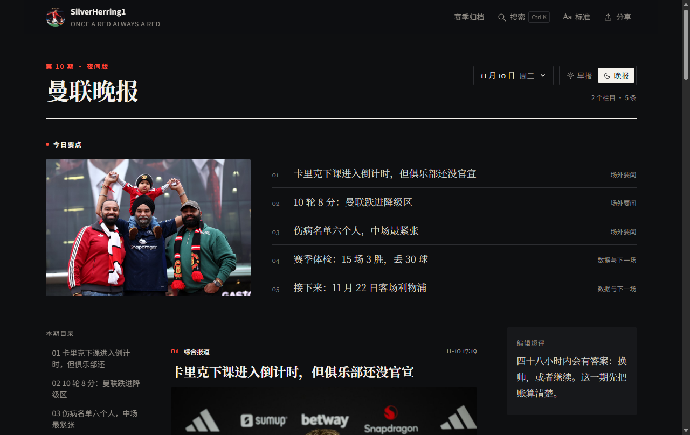

# 曼联日报

> 一个曼联球迷从 2018/19 赛季开始，一场一场记下来的看球记录。
>
> 不是为了追新闻，是为了把这些年看过的比赛、气过的夜晚、记下来的话，留个地方。

🔗 **在线阅读** → https://silverherring1.github.io/manutd-daily/

## 这是什么

一开始只是给自己做的一份「日报」：一场比赛一期，比分、进球、当时说的话、当时的排名。

后来把 `2018/19` 到 `2025/26` 八季的历史比赛也翻了进来，一季一季补，现在是这样：

| | |
|---|---|
| **9 个赛季** | 2018/19 → 2026/27 |
| **457 期** | 一场比赛一期，另加赛季总结期和场外新闻期 |
| **426 张比赛头图** | 每期「今日要点」左边那张 |
| **80 支对手** | 全部有队徽（FM 素材） |

同一份内容，**早报是纸白、晚报是夜黑**——配色跟着时段走，不跟系统深色模式走。

## 一季长什么样

每季一个归档页：淘汰赛路径（只画曼联这一条，止步那一轮标红）、欧战小组表（只放曼联那一组）、按月排的全部期次。



2018/19 举例：欧冠走到八强（16 强客场 3-1 翻盘巴黎）、联赛杯第三轮点球出局、足总杯八强，联赛第 6。

## 怎么读

- `Ctrl + K` 搜索全部期次（球员、对手、赛事都行）
- 点日期按**年 / 月 / 日**三级翻，只列有稿的那几天
- 顶栏「赛季归档」→ 按赛季看，重点场次带 ★
- 每篇新闻底下有「生成分享海报」，能存成图

## 一期里有什么

- **战报**：比分、进球时间线、当时的累计战绩
- **场边**：发布会原话（中英对照）、伤病、球员
- **今日要点**：左边一张比赛头图，右边本期条目
- **侧栏短评**：要么是我自己写一句，要么搬一条懂球帝热评（署名 + 原帖链接）

写稿有一条硬规矩：**当天视角**。写 10 月 11 日的稿子，就不知道后面九场不胜；累计战绩、连胜连败、赛季最大分差，都只算到这一场为止。

## 数据从哪来

| 用途 | 来源 |
|---|---|
| 赛程、比分、进球 | ESPN 公开接口（`data/archive/`） |
| 比赛头图 | ESPN 图集（多为 Getty / AFP 授权图） |
| 轮次、小组积分 | ESPN 接口 |
| 积分榜 | 懂球帝 |
| 热评 | 懂球帝文章评论区 |
| 队徽 | FM24 的 25×18 小图（个人使用） |

官方没发声的事，写「尚无官方声明」，不替它下结论。每条都附来源链接。

## 技术

原生 HTML/CSS/JS，没有框架、没有构建步骤。

```
data/
├── index.json          元信息
├── seasons.json        赛季总目
├── seasons/<赛季>/     一季一个文件夹：期次 JSON + index.json
├── archive/<赛季>.json 原始赛程（ESPN）
├── groups/  rounds/    欧战小组表、淘汰轮次
├── focus.json          每季焦点战（★）
├── records-manual.json 历史级纪录（手写）
└── images-<赛季>.json  头图索引
```

常用脚本：

```bash
python serve.py                                  # 本地预览（禁缓存）
node scripts/import-season.mjs 2018              # 抓一季赛程 → data/archive/
node scripts/fetch-archive-images.mjs 2018-19    # 抓一季头图
node scripts/build-rounds.mjs 2018-19            # 抓轮次
node scripts/build-groups.mjs                    # 抓欧战小组表
node scripts/build-focus.mjs                     # 按规则生成焦点战
node scripts/gen-archive-issues.mjs --all        # 一季 → 一期一期 + 归档页
node scripts/new-issue.mjs 2026-11-11 morning    # 新建一期（自动进对应赛季）
node scripts/fetch-boards.mjs                    # 积分榜
node scripts/check-size.mjs                       # 提交前看体积（预算 200 MB）
```

详细文档：

- [`docs/STATUS.md`](docs/STATUS.md) —— 做到哪了、待办
- [`docs/CONVENTIONS.md`](docs/CONVENTIONS.md) —— 编辑口径（时间、视角、点评、图片、来源）
- [`docs/DECISIONS.md`](docs/DECISIONS.md) —— 为什么这么定
- [`docs/WALKTHROUGH.md`](docs/WALKTHROUGH.md) —— 一个 JSON 怎么变成页面

## 关于

个人练手项目，内容靠人工整理，AI 参与查资料和排版。

比赛照片来自 ESPN 图集与曼联官网（版权属 Getty / 曼联），抗议照片来自 Sporting News，队徽是 FM 素材。**仅作个人阅读，不公开分发。**

早报 · 白天，浅色：



晚报 · 夜间，深色：


